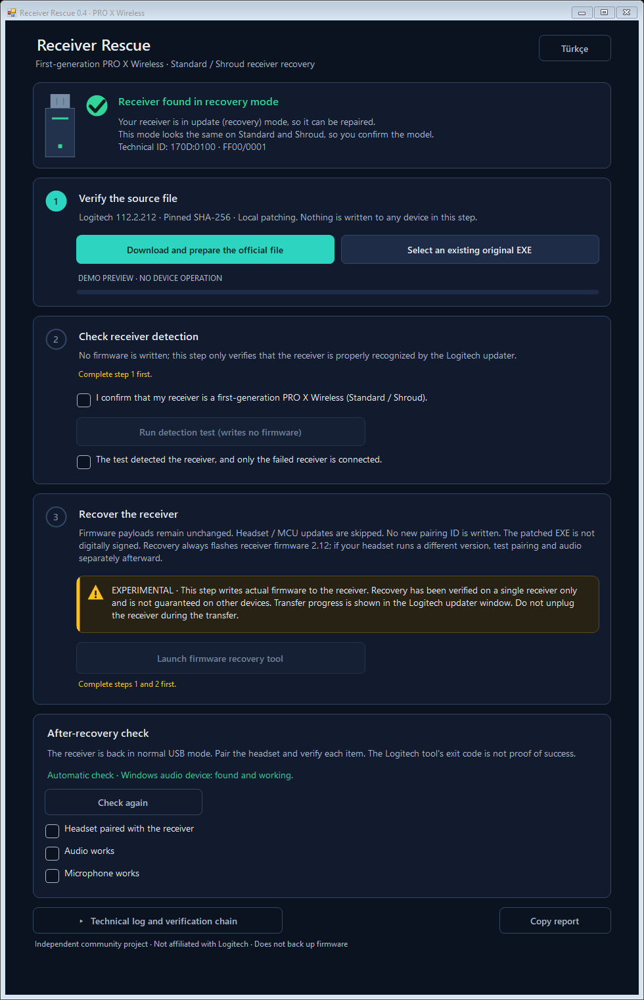

# Receiver Rescue 0.4.2

Experimental Windows recovery launcher for first-generation Logitech PRO X Wireless Standard / Shroud receivers.

[Türkçe kullanım](README.tr.md) · [Changelog](CHANGELOG.md)



## Is this your problem?

This tool is for one situation only: a first-generation Logitech PRO X Wireless (Standard / Shroud) receiver that stopped working after an interrupted or failed firmware update, and that Windows now lists as an Avnera **AV6201** device with the hardware ID `USB\VID_170D&PID_0100` (the receiver is "stuck in bootloader mode").

**How to check:** open Device Manager, right-click the device, choose Properties, then Details and select *Hardware Ids*. A working receiver shows `USB\VID_046D&PID_0ABA` instead; in that case do not use this tool. The launcher's status card also shows what it detects.

It is not for other Logitech models, receivers that still work, or the headset itself. It does not fix headset disconnections while charging.

## Download

**[ReceiverRescue-0.4.2.zip](downloads/ReceiverRescue-0.4.2.zip)** (use the **Download raw file** button on the file page)

SHA-256: `0e72a779ce7b65d2f9f7f8a36be419947a2ab466f02b387d5a61d56bdbcbd403`

Verify your download in PowerShell before opening it:

```powershell
Get-FileHash .\ReceiverRescue-0.4.2.zip -Algorithm SHA256
```

The program is not digitally signed, so Windows SmartScreen or your antivirus may show a warning, and Windows 11 Smart App Control, where it is switched on, can block it. Do not switch off Windows security features for this tool. The source code is in `src` so you can read it and build it yourself with `build.cmd` (Windows with .NET Framework 4.8, no extra tools) to run its `--self-test`. This is proprietary software, not open source: the source is for review and verification only, see [LICENSE](LICENSE).

## Run

Extract the ZIP completely, then open `ReceiverRescue.exe`. Keep the `manifests` folder beside it. Requires Windows 10/11 and .NET Framework 4.8; Logitech lists the pinned original updater for Windows 11.

The window shows three numbered steps. A step stays locked, with the reason written under it, until the previous one is complete.

1. Disconnect working receivers and the headset USB cable. Connect only the failed receiver.
2. The status card monitors normal receiver, recovery-mode (bootloader) receiver and headset USB states. Recovery requires one physical receiver in recovery mode (`170D:0100`) with a readable `FF00:0001` HID collection. Confirm the physical first-generation model yourself.
3. **Step 1:** download and prepare the official updater or select an existing unmodified Logitech 112.2.212 file. Its exact SHA-256 is verified.
4. **Step 2:** run the detection test and choose the correct physical edition in Logitech's window if prompted. The deliberately displayed “no update needed” message is a detection marker, not an installed-version reading or recovery result. This test sends no firmware packets.
5. **Step 3:** close the detection test, tick the confirmation and launch the recovery tool. A confirmation dialog appears first. Start the actual transfer in Logitech's native window. Do not disconnect USB until completion. While the Logitech tool runs, the launcher shows the elapsed time.
6. After the tool closes and a normal receiver is seen, an after-recovery check appears. The launcher checks automatically whether Windows lists a working PRO X audio device (there is a "Check again" button). Pair the headset and verify pairing, audio and microphone yourself; the automatic check does not prove that wireless audio works.

The top-right language button switches this launcher between English and Turkish. Logitech's separate native window uses its own language resources.

**Copy report** (bottom right) copies the launcher, Windows and .NET versions, the device-state history, pinned hashes, the automatic audio result, the checklist and the technical log to the clipboard, with your Windows user name, machine name and profile path masked. Review it before posting.

## Limits

One receiver recovery followed by pairing and audio was confirmed with the earlier 0.2.0 launcher. Versions 0.3 and 0.4 change the interface and add safety and convenience features (write-locked launch, elapsed time, automatic audio check, structured report); the device logic, patch manifests and output hashes are unchanged and the built-in self-tests pass, but the new versions have not been exercised against a physical failed receiver, and no other physically failed receiver has been flashed. All manufacturing revisions are not verified. Shared bootloader IDs do not prove a physical model. Normal receivers, headset USB, ambiguous targets and unsupported Avnera identities block firmware launch. USB-invisible devices cannot be recovered here.

Recovery always writes receiver firmware 2.12 and skips the updater's version check. It was verified with a headset whose radio firmware was also 2.12. If your headset runs a different firmware version, pairing and audio may behave differently (unverified); check them separately after recovery.

This does not update headset/MCU firmware, back up installed firmware or repair charging disconnects. Interrupted or incorrect firmware transfer can leave a receiver unusable. Use only with an already-failed matching receiver.

The source in `src` is published for review and verification only. The `manifests` folder contains required patch definitions. No Logitech updater binary or firmware payload is bundled. The original is downloaded and verified on the user's PC and patched locally. Both the community launcher and the patched updater are unsigned. This software is proprietary and not open source (see `LICENSE`): use it only to recover your own matching receiver; do not copy, modify or redistribute it or its patch definitions. Logitech files retain their original terms. This project is not affiliated with Logitech.

Downloaded/prepared files live in `%LOCALAPPDATA%\ReceiverRescue\112.2.212`. The launcher uploads no data.

## Security notes

See [SECURITY.md](SECURITY.md) for known limitations. Since 0.4.0 the patched updater is re-verified under a write lock before it is launched with administrator permission. Compare the SHA-256 values in `SHA256SUMS.txt` with your download before running anything.

## Reporting results

Results from other receivers are the most useful input for this project. Please open an Issue in this repository and include: whether the receiver was Standard or Shroud, the headset radio firmware version if known, whether recovery completed, and whether pairing, audio and microphone worked afterwards. Do not post personal file paths or serial numbers.

[Official updater](https://support.logi.com/hc/en-gb/articles/33930133950487-PRO-X-Wireless-Headset-Firmware-Update) · [Pairing instructions](https://support.logi.com/hc/en-us/articles/13086404966423-How-to-pair-your-PRO-X3-PRO-X2-PRO-X-headset-to-a-new-LIGHTSPEED-wireless-adapter)
