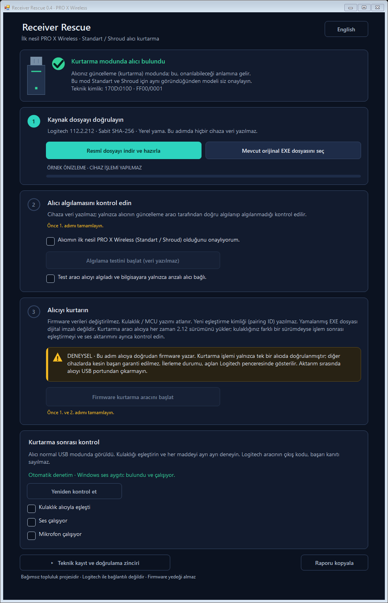

# Receiver Rescue 0.4.2

İlk nesil Logitech PRO X Wireless Standart / Shroud alıcı ailesi için deneysel kurtarma başlatıcısıdır.

[English](README.md) · [Değişiklik günlüğü](CHANGELOG.md)



## Sorun sizde mi?

Bu araç yalnızca tek bir durum içindir: yarım kalan veya başarısız olan bir firmware güncellemesinden sonra çalışmayı bırakan ve Windows'ta artık `USB\VID_170D&PID_0100` donanım kimliğiyle Avnera **AV6201** aygıtı olarak görünen ilk nesil Logitech PRO X Wireless (Standart / Shroud) alıcısı ("bootloader'da takılı kalmış" alıcı).

**Nasıl kontrol edilir:** Aygıt Yöneticisi'ni açın, aygıta sağ tıklayıp Özellikler'i, ardından Ayrıntılar sekmesini seçin ve *Donanım Kimlikleri*ne bakın. Çalışan bir alıcıda bunun yerine `USB\VID_046D&PID_0ABA` görünür; bu durumda bu aracı kullanmayın. Başlatıcının durum kartı da neyi algıladığını gösterir.

Bu araç; diğer Logitech modelleri, hâlâ çalışan alıcılar veya kulaklığın kendisi için değildir. Kulaklığın şarj sırasındaki bağlantı kopmalarını gidermez.

## İndirme

**[ReceiverRescue-0.4.2.zip](downloads/ReceiverRescue-0.4.2.zip)** (dosya sayfasındaki **Download raw file** düğmesini kullanın)

SHA-256: `0e72a779ce7b65d2f9f7f8a36be419947a2ab466f02b387d5a61d56bdbcbd403`

Dosyayı açmadan önce, indirdiğiniz dosyayı PowerShell'de doğrulayın:

```powershell
Get-FileHash .\ReceiverRescue-0.4.2.zip -Algorithm SHA256
```

Program dijital olarak imzalı olmadığından Windows SmartScreen veya antivirüs yazılımınız uyarı gösterebilir; Windows 11 Akıllı Uygulama Denetimi açıksa programı engelleyebilir. Bu araç için Windows güvenlik özelliklerini kapatmayın. Bu depo yalnızca hazır indirme dosyasını ve belgelerini içerir; kaynak kodu içermez. Bu yazılım tescillidir ve açık kaynak değildir: bkz. [LICENSE](LICENSE).

## Kullanım

Pencerede numaralandırılmış üç adım bulunur. Her adım, bir önceki adım tamamlanana kadar kilitli kalır; nedeni adımın altında belirtilir.

1. ZIP dosyasını kullanıyorsanız tamamen çıkarın. `ReceiverRescue.exe` dosyasını açın; `manifests` klasörü bu dosyanın yanında kalmalıdır.
2. Sağlam alıcıları ve kulaklığın USB kablosunu çıkarın. Bilgisayara yalnızca arızalı alıcı bağlı kalsın.
3. Durum kartı; normal alıcıyı, kurtarma (bootloader) modundaki alıcıyı ve kulaklığın USB durumunu otomatik olarak izler. `170D:0100` kimliği ve gerekli `FF00:0001` HID arayüzü bulunduğunda fiziksel ilk nesil modeli onaylayın.
4. **1. adım:** Resmî dosyayı indirip hazırlayın veya değiştirilmemiş orijinal Logitech 112.2.212 güncelleyicisini seçin. Dosyanın SHA-256 değeri doğrulanır.
5. **2. adım:** Algılama testini başlatın. Gerekirse Logitech penceresinde doğru Standart/Shroud sürümünü seçin. Testte görünen “güncelleme gerekmiyor” iletisi bir algılama işaretidir; cihaz sürümünün okunduğu veya kurtarmanın yapıldığı anlamına gelmez. Test, firmware göndermez.
6. **3. adım:** Testi kapatın, algılama onayını işaretleyin ve firmware kurtarma aracını başlatın. Önce bir onay penceresi görüntülenir. Gerçek yazımı, açılan Logitech penceresinde başlatın. İşlem tamamlanana kadar USB bağlantısını kesmeyin. Logitech aracı çalışırken başlatıcı geçen süreyi gösterir.
7. Araç kapandıktan ve normal alıcı görüldükten sonra kurtarma sonrası kontrol bölümü açılır. Başlatıcı, Windows'ta çalışan bir PRO X ses aygıtı olup olmadığını otomatik olarak kontrol eder ("Yeniden kontrol et" düğmesi vardır). Eşleştirmeyi, sesi ve mikrofonu yine de ayrı ayrı deneyin; otomatik kontrol, kablosuz sesin çalıştığını kanıtlamaz.

Sağ üstteki düğme, arayüz dilini Türkçe/İngilizce arasında değiştirir. Bu seçim yalnızca başlatıcıyı etkiler; Logitech penceresinin dili kendi kaynaklarına bağlıdır.

**Raporu kopyala** düğmesi (sağ altta); başlatıcı, Windows ve .NET sürümlerini, cihaz durumu geçmişini, sabit özet değerlerini (hash), otomatik ses sonucunu, kontrol listesini ve teknik kaydı panoya kopyalar. Windows kullanıcı adınız, makine adınız ve profil yolunuz maskelenir. Raporu paylaşmadan önce gözden geçiriniz.

## Kapsam ve sınırlar

- Bir alıcıda kurtarma, ardından eşleştirme ve ses, önceki 0.2.0 başlatıcısıyla doğrulanmıştır. 0.3 ve 0.4 sürümleri arayüzü değiştirmiş ve güvenlik/kolaylık özellikleri eklemiştir (yazmaya karşı kilitli başlatma, geçen süre, otomatik ses kontrolü, yapılandırılmış rapor); cihaz mantığı, yama tanımları ve çıktı özet değerleri aynıdır ve yerleşik testler başarıyla geçmektedir. Ancak yeni sürümler gerçek bir arızalı alıcıyla denenmemiş, başka bir fiziksel arızalı alıcıda yazım yapılmamıştır. Tüm üretim revizyonlarında başarı garanti edilmez.
- Kurtarma (bootloader) modundaki USB kimliği ortak olabilir; tek başına marka/model kanıtı sayılmaz. Fiziksel ilk nesil modelin onaylanması gerekir.
- Normal alıcı, kulaklığın USB bağlantısı, belirsiz veya desteklenmeyen hedeflerde yazım aracı engellenir. USB'de hiç görünmeyen cihazlar kurtarılamaz.
- Kulaklık/MCU firmware'ini güncellemez, mevcut firmware'in yedeğini almaz ve şarj sırasındaki bağlantı kopması sorununu gidermez.
- Kurtarma, alıcıya her zaman 2.12 sürümünü yazar ve güncelleyicinin sürüm kontrolünü atlar. Bu yöntem, kulaklığın radyo firmware'i de 2.12 olan bir cihazda doğrulanmıştır. Kulaklığınız farklı bir sürümdeyse eşleştirme ve ses farklı davranabilir (doğrulanmamıştır); kurtarmadan sonra bunları ayrıca kontrol edin.
- Firmware yazımı risklidir; yarıda kesilmesi alıcıyı kullanılamaz hâle getirebilir. Yalnızca eşleşen ve zaten arızalı alıcılar için kullanılmalıdır.

## Güvenlik notları

Bilinen sınırlamalar için [SECURITY.md](SECURITY.md) dosyasına bakınız. Yamalanan güncelleyici, 0.4.0 sürümünden itibaren yazmaya karşı kilitli olarak yeniden doğrulandıktan sonra yönetici izniyle başlatılır. Herhangi bir dosyayı çalıştırmadan önce, indirdiğiniz dosyayı `SHA256SUMS.txt` içindeki değerlerle karşılaştırın.

## Sonuç bildirme

Başka alıcılardan gelen sonuçlar bu proje için en değerli veridir. Lütfen bu depoda bir Issue açın ve şu bilgileri yazın: alıcının Standart mı Shroud mu olduğu, biliniyorsa kulaklığın radyo firmware sürümü, kurtarmanın tamamlanıp tamamlanmadığı ve sonrasında eşleştirmenin, sesin ve mikrofonun çalışıp çalışmadığı. Kişisel dosya yollarını veya seri numaralarını paylaşmayınız.

## Paket içeriği ve lisans

Bu paket kaynak kodu veya derleme betiği içermez. `manifests` klasörü, programın çalışması için gerekli yama tanımlarını içerir. Logitech güncelleyici EXE'si ve firmware verisi pakete dahil değildir; orijinal dosya, kullanıcının bilgisayarında indirilip doğrulanır ve yama yerel olarak uygulanır. Yamalanan EXE dijital olarak imzalı değildir; başlatıcı da dijital olarak imzalı değildir.

Yerel dosyalar `%LOCALAPPDATA%\ReceiverRescue\112.2.212` klasöründe tutulur. Program veri yüklemez. Windows 10/11 ve .NET Framework 4.8 gerekir; Logitech, orijinal güncelleyiciyi Windows 11 için listelemektedir.

Bağımsız bir topluluk projesidir; Logitech ile bağlantılı değildir. Bu yazılım tescillidir ve açık kaynak değildir (bkz. `LICENSE`): yalnızca kendi eşleşen alıcınızı kurtarmak için kullanın; yazılımı veya yama tanımlarını kopyalamayın, değiştirmeyin, dağıtmayın. Logitech dosyalarının lisansı değişmez.

[Resmî güncelleyici](https://support.logi.com/hc/en-gb/articles/33930133950487-PRO-X-Wireless-Headset-Firmware-Update) · [Eşleştirme yönergesi](https://support.logi.com/hc/en-us/articles/13086404966423-How-to-pair-your-PRO-X3-PRO-X2-PRO-X-headset-to-a-new-LIGHTSPEED-wireless-adapter)
